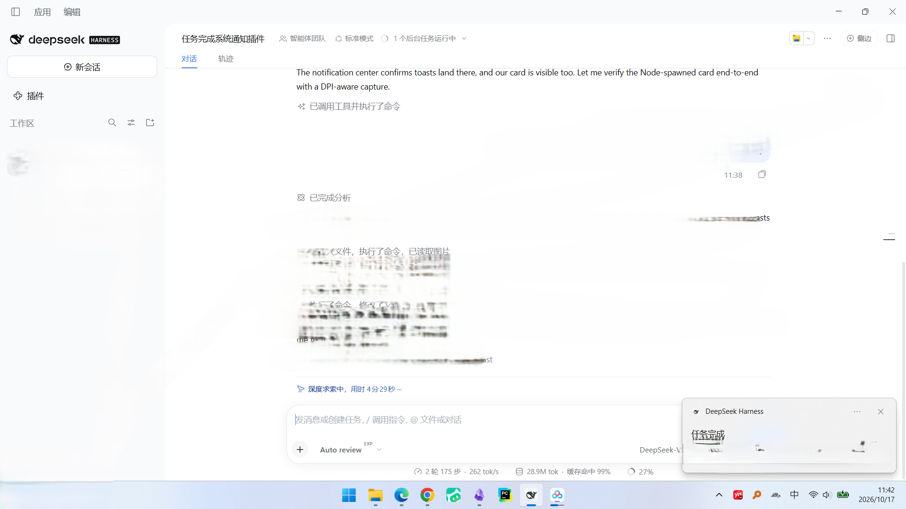
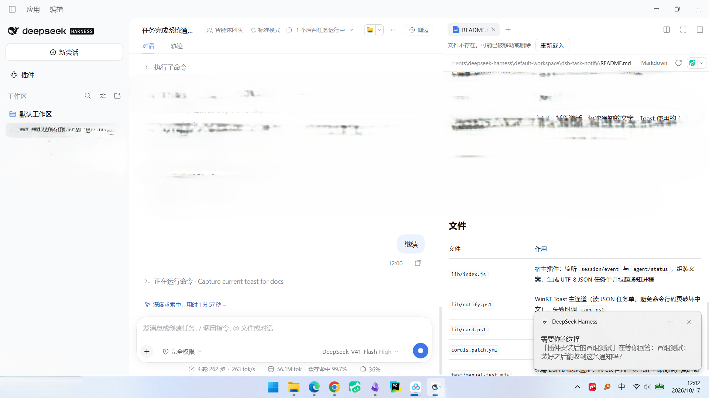

# dsh-agent-notify

[](LICENSE)
[](#requirements--环境要求)

DSH 插件：**Agent 需要你的时候，发一条真正的 Windows 系统通知**（WinRT Toast，右下角横幅 + Windows 通知中心，来源显示 “DeepSeek Harness”，点击可回到应用）。

A DeepSeek Harness (dsh) plugin that raises **real Windows notifications** — WinRT toasts that land in the Action Center under the app's own name — at the three moments the agent stops and waits for you.

| 时机 | 触发事件 | 通知标题 |
| --- | --- | --- |
| 任务跑完 | `agent/status` 从 `running` 回到 `idle`（期间有 `turn/end`） | 任务完成 / 任务出错 / 任务被拦截 …（按结束原因） |
| 需要授权 | 会话事件 `approval/asked`（工具调用被权限确认卡住） | 需要你的授权 |
| 需要你选择 | 会话事件 `tool/call` 且工具为 `ask_user_question` | 需要你的选择 |

| Moment | Hook | Notification |
| --- | --- | --- |
| Run finished | `agent/status` goes `running` → `idle` after a closed turn | per-reason headline: completed / error / blocked / interrupted / … |
| Waiting for approval | `approval/asked` session event | 需要你的授权 |
| Waiting for a choice | `tool/call` where the tool is `ask_user_question` | 需要你的选择 |

子会话（subagent）全部跳过，所以 agent team / 子代理不会刷屏；同一会话同类等待通知默认 20 秒冷却，重试不会连发。

Subagent sessions are skipped entirely, so a team of delegates never spams the desktop, and waiting alerts are rate-limited per session and kind (20 s by default) so retries cannot machine-gun you.





## Requirements / 环境要求

- **Windows 10/11**，且 `WindowsPowerShell\v1.0\powershell.exe` 存在（WinRT 投影只在 PowerShell 5.1 里可用；`pwsh` 7 反而没有）。 / Windows 10/11 with Windows PowerShell 5.1 — the WinRT projection is the reason this uses `powershell.exe` rather than `pwsh`.
- **DeepSeek Harness 桌面版**（通知以它的 AppUserModelID 发送，来源才显示 “DeepSeek Harness”）。 / the DSH desktop app, whose AUMID the toast is sent under.
- Node ≥ 20。

## 安装 / Install

从市场或 GitHub 装（任意非 `desktop` profile）：

```powershell
dsh plugin add --profile web github:Ssupervipuser/dsh-agent-notify
```

`desktop` profile 由 Electron 应用自己管理（`dsh plugin` 会拒绝写它），所以桌面版请用仓库自带的安装脚本：

```powershell
git clone https://github.com/Ssupervipuser/dsh-agent-notify.git
node dsh-agent-notify/test/install.mjs
```

该脚本会：备份 profile 清单 → 发布 `lib/releases/impl-<build>.js` → 写入稳定入口 shim → 更新 `package.json` 依赖与 `dsh.profile.bundles`。

> **git 托管插件首次安装可能被 pnpm 拦住**：pnpm 默认不允许执行 `prepare` 脚本。如果 `dsh plugin add` 失败并打印了一个 key，把它加到 profile 的 `pnpm-workspace.yaml` 的 `allowBuilds` 下再重跑即可。

验证安装：`node test/installed-smoke.mjs` 会检查安装副本的 shim、`current-build.txt`、两个 `.ps1` 是否齐全。

## 配置 / Configuration

在 profile 的 `cordis.patch.yml` 里覆盖 `agent-notify` 这一行的 `config`（**整段替换**，保留需要的键）：

| 键 | 默认 | 含义 |
| --- | --- | --- |
| `enabled` | `true` | 总开关 |
| `minDurationSec` | `0` | 只通知耗时超过 N 秒的“任务完成”（0 = 总是通知） |
| `duration` | `long` | Toast 停留时长：`long`（≈25 秒）/ `short`（≈5 秒） |
| `silent` | `false` | 静音（`silent="true"`） |
| `appId` | `''` | 指定 AppUserModelID；空 = 先用桌面应用自己的 AUMID |
| `fallbackCard` | `true` | Toast 不可用时是否画兜底卡片 |
| `cardSeconds` | `8` | 兜底卡片停留秒数 |
| `skipWhenForeground` | `false` | 当前窗口标题已包含该会话时跳过通知 |
| `title` | `''` | 覆盖“任务完成”标题行；空 = 按结束原因自动取 |
| `notifyApprovals` | `true` | 权限请求（需要授权）时通知 |
| `notifyQuestions` | `true` | 需要用户选择/回答时通知 |
| `alertCooldownSec` | `20` | 同一会话同类等待通知的最小间隔（秒） |

例如只保留“任务结束”通知、静音、且只在任务超过 30 秒时提醒：

```yaml
- id: agent-notify
  config:
    enabled: true
    minDurationSec: 30
    duration: long
    silent: true
    appId: ''
    fallbackCard: true
    cardSeconds: 8
    skipWhenForeground: false
    title: ''
    notifyApprovals: false
    notifyQuestions: false
    alertCooldownSec: 20
```

## 通道 / Delivery

- **主通道**：`lib/notify.ps1` 调 WinRT `ToastNotificationManager`，用 DSH 桌面应用自己的 AppUserModelID（`com.deepseek.dsh`）发送，所以系统里显示为 “DeepSeek Harness” 的通知，进通知中心、可点回应用。
- **兜底**：系统没有 Toast API 或 AUMID 被拒时，用 `lib/card.ps1` 画一张原生置顶卡片（不是网页弹窗）。
- **中文不乱码**：文案通过 UTF-8 JSON 任务单文件传给 PowerShell，不走命令行码页。

## 更新 / 热更新

DSH 宿主按 URL 缓存 ESM 模块，直接改入口文件不会生效。所以安装副本里 `lib/index.js` 是一个永不变化的 shim，它每次激活时读 `lib/current-build.txt` 并 `import()` 对应的 `lib/releases/impl-*.js`；重新发布后只要配置重载（保存 profile `package.json` / 行开关切换都会触发），新代码就生效，**无需重启应用**。工作区里的 `lib/index.js` 始终是真正的实现源码。

如果改了 `lib/index.js` 之后没有自动生效：切换一下插件行开关（`cordis.patch.yml` 里 `- id: agent-notify` + `disabled: true` 保存，再改回 `false`），或重启应用。

## 卸载 / Uninstall

1. 从 profile `package.json` 的 `dsh.profile.bundles` 与 `dependencies` 删掉 `dsh-agent-notify`；
2. 删除 `node_modules/dsh-agent-notify`；
3. 保存后配置自动重载，通知即停止。

或者用 `dsh plugin remove --profile <name> dsh-agent-notify`。

## 排查 / Troubleshooting

日志：`%TEMP%\dsh-agent-notify.log`（插件激活、每次通知文案、Toast 用的 AUMID 与结果、兜底卡片是否触发）。

- **通知没出现**：确认 Windows 设置 → 系统 → 通知里 “DeepSeek Harness” 是开启的，且没开专注/勿扰；勿扰时横幅不弹，但会进通知中心。
- **Toast 被拒**：日志出现 `toast rejected appId=...` 时会走卡片兜底，可用配置 `appId` 指定其他已注册 AUMID。
- **子会话不通知**：故意设计。
- **本地验证**：`node test/manual-test.mjs` 用假 ctx 回放一次 run + 授权 + 提问，会真的弹出三条通知（并自检文案/冷却逻辑）。

## 设计说明 / Notes on the install script

> **Windows 硬链接**：pnpm 安装 `file:` 依赖时是用**硬链接**把插件连进 `node_modules` 的，所以安装副本里的文件和插件源码通常是**同一个文件**（`fsutil hardlink list <安装副本里的文件>` 会同时列出两个路径）。此时往里写不是“复制”而是**直接改源文件**：`writeFileSync` 会把源码截断成 shim，`cpSync` 会直接报 `ERR_FS_CP_EINVAL`。脚本已在每次写入前先 `rmSync` 掉目标目录项（`detach()`）来断开硬链接，所以正常情况是安全的；跑完会打印 `broke N hardlink(s)` 告诉你断开了哪些。
>
> 想验证这一点（不会动到真实 profile）：`node test/hardlink-safety.mjs`，它在临时目录里按同样方式建硬链接再跑安装，然后断言源码哈希没变。也可以设 `DSH_PROFILE_DIR=<某目录>` 把安装重定向到沙盒里。**该测试会拒绝跨盘（EXDEV）**，如果 `node_modules` 和插件源码不在同一个卷上，把 `TEMP` 指到源码所在的卷再跑。
>
> **目录重解析点（junction / 符号链接）**：硬链接是“同一个文件”，而 junction 是“同一个目录”，后者更危险：如果 `node_modules\dsh-agent-notify`（或它下面的 `lib`）是指向插件源码的 junction（pnpm `link:`、`link-workspace-packages`、`npm link` 都会造成这种布局），那么目标路径和源路径就指向同一个文件，`detach()` 的 `rmSync` 会**删掉源码本身**，紧接着 `cpSync` 因找不到源文件而报 `ENOENT` 退出——源码树会被写坏甚至清空。硬链接对 `realpathSync` 不可见，所以 `detach()` 这种“先删后写”的做法对 junction 无解。脚本因此在**任何写入之前**先做 `realpathSync` 检查，一旦发现 profile、安装目录、`lib`、`lib/releases` 或清单文件解析进了插件源码树，就直接拒绝安装并报 `resolves into the canonical plugin`。

## 文件 / Files

| 文件 | 作用 |
| --- | --- |
| `lib/index.js` | 宿主插件实现：监听 `session/event`、`agent/status`，组装文案，生成 UTF-8 JSON 任务单并拉起通知进程 |
| `lib/notify.ps1` | WinRT Toast 主通道（读 JSON 任务单），失败时调 `card.ps1` |
| `lib/card.ps1` | 原生置顶通知卡片（兜底） |
| `cordis.patch.yml` | bundle patch：插入 `agent-notify` 行 |
| `screenshots.json` | 市场详情页截图声明 |
| `test/manual-test.mjs` | 无 DSH 的本地验证（逻辑自检 + 真实弹通知） |
| `test/install.mjs` | 安装/更新到 profile（含热更新 shim；写入前断开硬链接） |
| `test/installed-smoke.mjs` | 安装后的冒烟检查 |
| `test/hardlink-safety.mjs` | 回归测试：在沙盒里复现 pnpm 硬链接布局 + junction 布局，断言安装不会破坏源码、且会拒绝目录重解析点 |
| `test/hot-reload-probe.mjs` | 切换插件行开关，验证配置重载 |
| `docs/toast-run-finished.png` | 实测截图：任务完成通知 |
| `docs/toast-waiting.png` | 实测截图：需要选择通知 |

## Security / 安全

这个插件会在**你本机执行 PowerShell**：每次通知都会用 `powershell.exe -File lib/notify.ps1` 起一个短命子进程，把文案以 UTF-8 JSON 任务单文件传给脚本。没有网络请求，不读取凭据，不写插件目录以外的文件（除 `%TEMP%` 下的日志与任务单）。通知里的文本来自会话标题和工具参数，写入 JSON 前不经过 shell，因此不会被拼进命令行。

The plugin executes PowerShell locally: one short-lived `powershell.exe` child per notification, fed by a JSON task file. It makes no network requests, reads no credentials, and writes nothing outside `%TEMP%`.

## License

[MIT](LICENSE)
